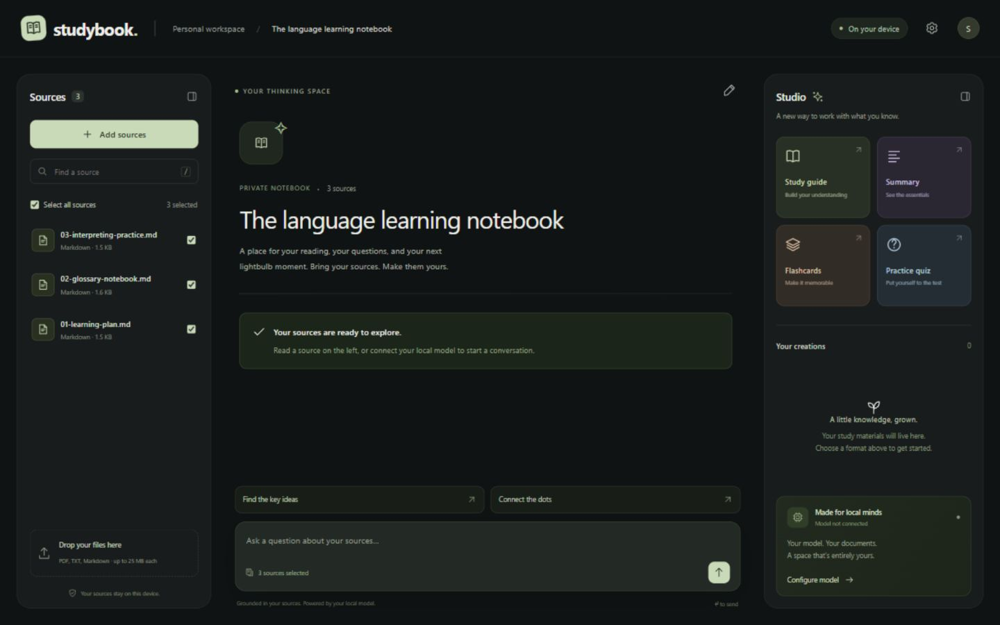
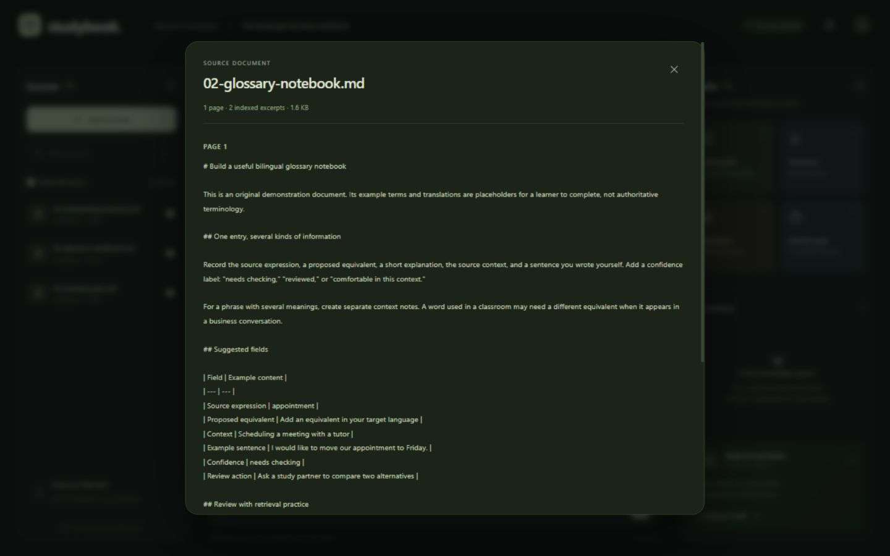
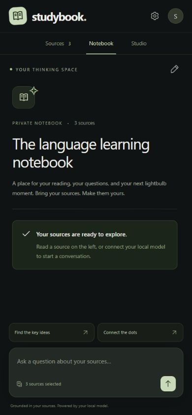
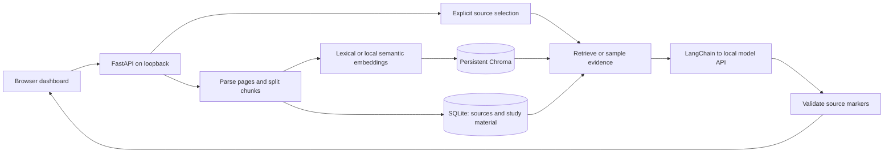

# Studybook

[](https://github.com/Khayoon/studybook-local-rag/actions/workflows/ci.yml)

**Your documents, a conversation, and a place to study — on your own computer.**

Studybook is a local multi-document RAG workspace. Bring together PDFs, text files, and Markdown notes; ask questions across selected sources; and turn the evidence into study guides, summaries, flashcards, and practice quizzes. Citations open the exact document excerpt supplied to the model.

Built with **Python · FastAPI · LangChain · Chroma · SQLite · vanilla JavaScript**. The responsive interface needs no frontend build step or external CDN.



*The running interface with original sample documents. The screenshot demonstrates the workspace, not generated model output.*

<details>
<summary>Explore the source reader and mobile layout</summary>

### Source reader



### Mobile layout



*Screenshots of the running application with sample documents. No generated answers are shown.*

</details>

**Status:** ingestion, local persistence, source selection, and lexical retrieval work without a model. Chat and studio generation are implemented for a local OpenAI-compatible API; their request/response paths are tested with deterministic fixtures. Live LLM generation and semantic retrieval quality have not yet been evaluated.

## What you can do

- **Build a source library:** upload multiple PDF, TXT, `.md`, or `.markdown` files, read extracted pages, and download originals. Duplicate content is detected with SHA-256.
- **Choose the scope:** chat across all selected documents or a smaller set. An empty selection searches nothing; changing it clears the active conversation.
- **Inspect the evidence:** follow document, page, and chunk citations. Unknown source markers are labeled unverified instead of becoming working links.
- **Create study material:** generate structured Markdown summaries, study guides, flashcards, and quizzes; reopen saved results and export them with cited excerpts.
- **Keep the workflow local:** Chroma and SQLite persist on disk. Model endpoints are restricted to loopback addresses, and starting the dashboard does not contact or launch a model.

## Try it

Requires Python **3.11 or newer**. Clone the repository, or download its ZIP and open a terminal in the extracted folder.

```sh
git clone https://github.com/Khayoon/studybook-local-rag.git
cd studybook-local-rag
```

### Windows

```powershell
.\Setup-Studybook.ps1
.\Start-Studybook.ps1
```

Open **[http://127.0.0.1:8765](http://127.0.0.1:8765)** and choose **Try a sample notebook**. Inspect the three sources immediately; connect a local model when you want to generate answers. The sample documents are original educational examples, not certification or legal guidance.

For subsequent starts, double-click `start.cmd`. Stop the server with Ctrl+C. Use `Start-Studybook.ps1 -Port 8766` to choose another port. Setup accepts `-Python 'C:\path\to\python.exe'` if you need to select an installation.

### macOS / Linux

```sh
python3 -m venv .venv
. .venv/bin/activate
python -m pip install -r requirements.txt
cp .env.example .env
python -m uvicorn backend.main:app --host 127.0.0.1 --port 8765
```

These are the standard cross-platform launch commands. The initial application and browser checks were performed on Windows. Windows setup uses the exact versions in `requirements.lock.txt`, verified with Python 3.13; `requirements.txt` provides compatible ranges for other environments.

## Connect a local model

Configure the endpoint and model in **Settings**, or edit `.env` before the first launch:

```dotenv
STUDYBOOK_BASE_URL=http://127.0.0.1:8090/v1
STUDYBOOK_MODEL=your-local-chat-model-id
STUDYBOOK_EMBEDDING_MODE=lexical
```

Use the exact model identifier accepted by your server. The base URL includes `/v1`, not `/chat/completions`. Saving settings is passive; **Test saved connection** explicitly calls `/models`. The model server is managed separately.

| Retrieval mode | What it does | Requirements |
| --- | --- | --- |
| `lexical` (default) | Ranks deterministic hashed word vectors stored in Chroma. Useful for keyword matches and exploring the full source workflow. | No model download or inference server. |
| `local_openai` | Uses a local semantic embedding model through `/embeddings`. | Set `STUDYBOOK_EMBEDDING_MODEL`; the configured local API must serve that embedding model. |

The default index is a lexical baseline: synonyms, paraphrases, and cross-language matches can be missed. A chat model and an embedding model serve different roles. Both API paths currently share one base URL. Changing embedding identity requires deleting indexed sources and reimporting them so incompatible vectors cannot mix.

Settings saved in the interface take precedence over `.env`. An API key supplied through Settings lasts for the running process only; use `STUDYBOOK_API_KEY` in the ignored `.env` file for persistent configuration.

## Architecture



[Architecture and API](docs/architecture.md) explains ingestion, evidence selection, storage, and trust boundaries. [Engineering decisions](docs/decisions.md) records the tradeoffs and next improvements.

| Where to look | Responsibility |
| --- | --- |
| [`backend/core.py`](backend/core.py) | Parsing, embeddings, persistence, retrieval, generation, and citation validation. |
| [`backend/main.py`](backend/main.py) | FastAPI routes, request validation, local request guards, and static serving. |
| [`frontend/`](frontend/) | Responsive source library, conversation, study studio, and readers. |
| [`rag_starter.py`](rag_starter.py) | Runnable Python/LangChain CLI using the same backend. |
| [`tests/test_backend.py`](tests/test_backend.py) | Offline unit, API, persistence, and model-client transport tests. |

## Python / LangChain starter

The CLI uses `.studybook-script/` by default, separately from the dashboard's `.studybook/` data:

```sh
# Run with the virtual environment's Python.
python rag_starter.py ingest examples/01-learning-plan.md examples/02-glossary-notebook.md
python rag_starter.py search "glossary learning journal"
python rag_starter.py list

# Requires your local model server to be ready:
python rag_starter.py ask "How should I review glossary entries?"
python rag_starter.py generate study_guide
```

On Windows, use `.\.venv\Scripts\python.exe` in place of `python` if the environment is not activated. `search`, `ask`, and `generate` accept repeated `--source DOCUMENT_ID` flags; omitting them selects the whole CLI collection. Put `--data-dir PATH` before the subcommand to choose a data directory.

The running backend also exposes interactive [API documentation](http://127.0.0.1:8765/docs).

## Verification

```sh
python -m unittest discover -s tests -v
python -m pip check
node --check frontend/app.js
```

Node.js is optional for development checks; it is not needed to run the application. Install the frontend development tools with `npm ci`, then use `npm run format:check` to check formatting or `npm run format` to apply it.

The offline backend suite covers ingestion, Unicode text, PDF page provenance and decompression limits, duplicate detection, persistence, selected-source isolation, citation filtering, artifact export, and local endpoint restrictions. Transport tests use the real LangChain `ChatOpenAI` and `OpenAIEmbeddings` clients with an in-memory HTTP transport; no inference service is contacted.

Browser verification covers sample imports, source reading and selection, settings, and desktop/mobile layouts. Generation UI checks use [`tests/ui_fixture_server.py`](tests/ui_fixture_server.py), an isolated temporary notebook whose responses are explicitly labeled as test fixtures. That fixture verifies chat rendering, citation navigation, saved studio items, and Markdown downloads. It is never used by the production server.

These checks establish application behavior. They do not establish answer accuracy, compatibility with a particular live model, or semantic retrieval quality.

## Scope and limitations

- This is a **single-user local application**, with no accounts, shared workspaces, or hosted deployment. Keep its listener on loopback.
- Citations validate where an excerpt came from; they do not prove that a generated claim follows from it. Read the cited passage when accuracy matters.
- Studio results use bounded samples across selected documents and display coverage counts. A guide is not necessarily a review of every page.
- PDFs must contain extractable text. OCR, complex layout reconstruction, web research, audio, slides, and video generation are outside the current scope.
- Uploaded sources and studio items persist locally. Chat messages live only in the open page; notebook titles and selected-source IDs are remembered by that browser.
- Studybook restricts its model traffic to local endpoints and disables its configured tracing/telemetry. Package installation and the independently operated model server have their own network behavior.

## What this project demonstrates

An end-to-end application with explicit evidence provenance, a reusable backend shared by HTTP and CLI clients, source-scoped retrieval, durable local storage, and meaningful tests at the API and model-client boundaries. The design keeps retrieval quality, citation validity, and model quality separate so each can be evaluated honestly.

## License

[MIT](LICENSE). Third-party dependencies retain their own licenses.
