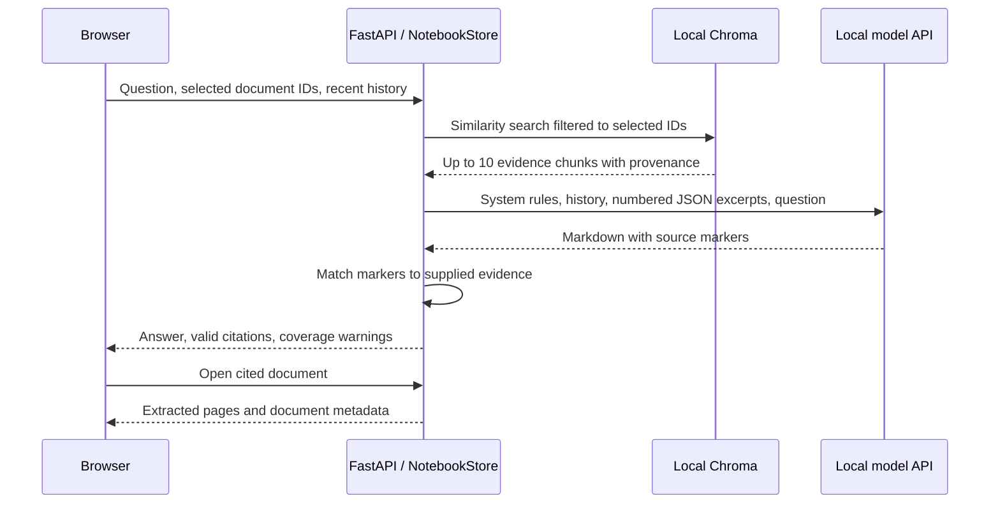

# Architecture

Studybook is a single-process, single-user application. FastAPI serves both the browser interface and the JSON API. `NotebookStore` owns parsing, the local index, source records, and generation, and is shared by the dashboard and the command-line starter.

## Ingestion and persistence

1. Accept a batch of PDF, UTF-8 TXT, or Markdown files. Validate names, types, sizes, and extractable text; report failures per file while retaining successful imports.
2. Hash the original bytes with SHA-256 to avoid indexing duplicate content. Store originals under generated IDs rather than user-controlled paths.
3. Extract PDF text page by page with `pypdf`, retaining one-based page numbers. Text and Markdown files are represented as one text page.
4. Split each page with LangChain's `RecursiveCharacterTextSplitter`: approximately 1,100 characters per chunk and 180 characters of overlap. Retain `document_id`, `document_name`, `page`, and document-wide `chunk` number on every chunk.
5. Generate lexical or local semantic vectors, write them to persistent Chroma in bounded batches, and save document, page, and chunk records to SQLite.

The default data directory is `.studybook/`; `STUDYBOOK_DATA_DIR` can select another directory. The CLI defaults to `.studybook-script/` to keep experiments separate.

```text
.studybook/
  notebook.sqlite3   Document metadata, extracted pages, chunks, saved studio items
  settings.json     Model and embedding settings, without the API key
  uploads/          Original files under generated names
  vectors/          Persistent Chroma data
```

SQLite uses write-ahead logging. An in-process reentrant lock protects shared store operations. Ingestion rolls back the SQLite transaction and attempts to remove written vectors and the original file when an operation fails. These stores do not form a distributed transaction; a hard process failure between writes remains a recovery case for future work.

| Bound | Current value |
| --- | --- |
| Upload size | 25 MB per file |
| Batch size | 20 files |
| PDF pages | 1,000 |
| Extracted text | 2 million characters per file |
| Chunks | 3,000 per file |
| Selected documents | 40 per request |

PDF decoding also limits stream expansion and selected parser operations. These are application safeguards, not an operating-system parser sandbox. Encrypted PDFs and image-only PDFs are rejected with actionable errors.

## Question answering



Document IDs are explicit on every chat request. Selecting no sources never falls back to the whole corpus. The previous user question may be included in the retrieval query to help resolve short follow-ups; the last six conversation messages are included in the prompt with bounded message length. Previous assistant text is not considered source evidence.

The default lexical mode normalizes signed word counts into 1,024-dimensional hashed vectors and searches by cosine distance. It additionally removes candidates that share no words with the query. This is approximate lexical retrieval, not a learned semantic encoder. When no matching excerpts remain, the backend returns an insufficient-evidence response without invoking the model.

Semantic mode uses LangChain `OpenAIEmbeddings` with raw text requests to the configured local `/embeddings` endpoint. Tokenizer-driven context checking is disabled so a remote tokenizer or a particular provider's token IDs are not needed for this local interface. Chat uses `ChatOpenAI` with a 120-second timeout, no automatic retries, temperature 0.2, and a 2,300-token output limit. Responses are currently delivered as complete messages rather than streamed tokens.

## Study studio

Summaries, study guides, flashcards, and quizzes use different structure instructions over source excerpts. The structure is requested as Markdown; the application does not enforce a typed JSON schema for the generated content.

For broad overviews, the backend samples evenly spaced chunks from every selected document instead of letting one similarity query dominate the selection. Each document contributes up to eight excerpts; the usual total budget is 32, with at least one excerpt per selected source, up to 40 sources. The output states how many indexed excerpts were supplied and whether the overview was sampled.

Completed artifacts are saved in SQLite with their source IDs, citation excerpts, warnings, kind, and creation time. Markdown export includes the generated content and the cited excerpt text, so provenance remains readable outside the app. Artifacts are snapshots: changing or deleting a source does not rewrite an earlier generated artifact.

## Citation contract

Evidence supplied to the model receives request-local markers such as `[S1]`. The response is checked against that request's evidence map:

- A known marker becomes a citation object with document ID, name, page, chunk, and the supplied excerpt.
- An unknown marker becomes `[unverified source]` and produces a warning.
- An answer with no valid citation markers produces an unverified-answer warning.

This verifies source identity, not semantic entailment. A model can still cite a real passage incorrectly. TXT and Markdown citations use page 1 plus the chunk number and excerpt; they are not line-level anchors.

## Local trust boundaries

| Boundary | Implemented behavior | Remaining responsibility |
| --- | --- | --- |
| Browser → backend | Loopback launch scripts, host validation, same-origin checks on API requests, validated request bodies. | This is not user authentication or network deployment isolation. |
| Backend → model | Loopback-only URLs, `localhost` normalized to a literal address, redirects disabled, environment proxies ignored. | The separately run model server controls its own behavior and network access. |
| Uploaded text → prompt | Source text is serialized as explicitly untrusted JSON; system instructions say document commands are data. | Prompt separation cannot guarantee a model will resist every injection. |
| Source/model text → DOM | Text is escaped before the limited Markdown renderer adds markup; originals are attachment downloads. | Model correctness still requires review. |
| Configuration → disk | Saved settings omit API keys; UI-supplied keys remain in process memory. | A persistent `.env` key is plaintext on local disk and should stay private. |

Health checks and settings saves are passive. Only an explicit connection test, embedding request in semantic mode, chat request with evidence, or studio generation needs model-server communication. Studybook does not download model weights or manage model processes.

## HTTP API

Interactive schemas are available at `/docs` on the running local server.

| Method and path | Purpose |
| --- | --- |
| `GET /api/health` | Cached application/model state; no model request. |
| `GET /api/settings`, `PUT /api/settings` | Read or save model configuration. |
| `POST /api/connection` | Explicitly request the configured local `/models` endpoint. |
| `GET /api/documents` | List sources. |
| `POST /api/documents` | Import multipart `files`; return successful documents and per-file errors. |
| `GET /api/documents/{id}/content` | Read extracted pages and source metadata. |
| `GET /api/documents/{id}/file` | Download the original file. |
| `DELETE /api/documents/{id}` | Delete the source, extracted pages, and vectors. |
| `POST /api/chat` | Ask with `message`, explicit `document_ids`, and optional `history`. |
| `GET /api/studio`, `POST /api/studio` | List or generate saved study material. |
| `GET /api/studio/{id}/export` | Download an artifact and citations as UTF-8 Markdown. |
| `DELETE /api/studio/{id}` | Delete a saved artifact. |

Example upload with the application running:

```sh
curl -X POST http://127.0.0.1:8765/api/documents \
  -F "files=@examples/01-learning-plan.md"
```

Use `curl.exe` in Windows PowerShell. The returned document ID can be included in the `document_ids` array of a chat or studio request.
